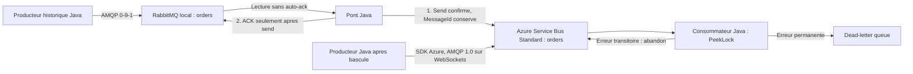

## Une migration progressive, pas un remplacement de protocole

Migrez des commandes e-commerce depuis RabbitMQ local vers un vrai Azure Service Bus.
Le pont conserve les identifiants des messages et acquitte RabbitMQ uniquement apres
confirmation d'envoi Service Bus. Une coupure volontaire rend visible la redelivery
RabbitMQ et la deduplication Service Bus. Le producteur bascule ensuite vers le SDK Azure.

Le scenario dure environ 15 a 20 minutes apres installation. Il contient du code Java 17,
une infrastructure Bicep, des scripts PowerShell 7 et un guide presentateur.
Il ne deploie aucune application dans Azure : les processus Java tournent sur votre poste.

> [!WARNING]
> Service Bus Standard est payant tant que le namespace existe, meme sans trafic.
> Consultez la [tarification Service Bus](https://azure.microsoft.com/pricing/details/service-bus/).
> Le nettoyage de la file seule ne supprime pas le namespace ni sa facturation.
> Cette demo n'est pas un outil de migration de production.



## Demarrage client

Utilisez **vos propres** identifiants de tenant et d'abonnement.
Aucun abonnement, identifiant de personne ou secret de l'auteur n'est necessaire.
Les commandes suivantes sont prevues pour PowerShell 7 sur Windows.

### Installer les prerequis

* JDK 17 ou plus recent, avec `java` et `javac` dans le PATH
* PowerShell 7, lance avec `pwsh`
* Docker Desktop demarre, moteur Linux et Docker Compose disponibles
* Azure CLI avec Bicep (`az bicep install` si absent)
* Un abonnement autorisant Microsoft.ServiceBus en France Central
* Des droits de creation de groupe et de namespace, ainsi que d'attribution RBAC

Un Contributor seul ne suffit pas pour creer les role assignments.
Utilisez les droits approuves par votre organisation, par exemple Contributor plus
Role Based Access Control Administrator sur le perimetre concerne.
Ce template de niveau abonnement necessite les droits de deploiement correspondants.
La resolution du compte local utilise l'object ID du jeton ARM de l'abonnement cible,
pour eviter de confondre l'objet du tenant d'origine avec un compte invite.
Le jeton n'est ni affiche ni ecrit dans un fichier.

Maven est optionnel sur le poste : `build.ps1` telecharge Maven 3.9.11 dans `.tools`
si absent et verifie son SHA512. Java, Docker, PowerShell et Azure CLI ne sont pas
installes automatiquement. Les premiers lancements necessitent un acces Internet
a Maven Central, Docker Hub, Microsoft Entra et Azure.

### Cloner et construire

```powershell
git clone https://github.com/Ch0wseth/rabbitmq-to-azure-servicebus-java.git
Set-Location .\rabbitmq-to-azure-servicebus-java
.\scripts\build.ps1
```

Le resultat est `target\migration-demo.jar`.

### Choisir la cible Azure et previsualiser

```powershell
$tenant = '<VOTRE-TENANT-ID>'
$subscription = '<VOTRE-SUBSCRIPTION-ID>'
az login --tenant $tenant
az provider show --namespace Microsoft.ServiceBus --subscription $subscription --query registrationState
# Si necessaire et autorise par votre administrateur :
# az provider register --namespace Microsoft.ServiceBus --subscription $subscription --wait

.\scripts\deploy.ps1 -TenantId $tenant -SubscriptionId $subscription
```

Sans `-Apply`, le script execute uniquement un `what-if`.
Verifiez la liste des creations proposees et les regles de votre organisation.
Le script ne change pas l'abonnement Azure CLI par defaut.
Il refuse un groupe existant qui ne porte pas le tag d'appartenance de la demo.
Choisissez toujours un groupe dedie, sans ressource client a conserver.

### Deployer

```powershell
.\scripts\deploy.ps1 -TenantId $tenant -SubscriptionId $subscription -Apply
. .\local.ps1
```

Par defaut, Bicep cree :

* Le groupe dedie `rg-rabbitmq-servicebus-demo`
* Un namespace au nom unique, en France Central, SKU Standard
* La file `orders`, avec deduplication pendant 10 minutes et trois livraisons maximum
* Les roles Data Sender et Data Receiver pour l'utilisateur connecte, limites a `orders`

L'authentification locale utilise `AzureCliCredential` et Microsoft Entra.
Les cles SAS sont desactivees sur le namespace. TLS 1.2 minimum est configure.
La connexion utilise AMQP sur WebSockets, TCP 443, pour limiter les problemes de proxy.
Un proxy peut neanmoins filtrer les WebSockets.
Le point d'acces Azure est public avec authentification Entra, pas un Private Endpoint.
Adaptez le reseau avec votre equipe plateforme pour une utilisation hors laboratoire.

La propagation RBAC peut prendre plusieurs minutes. Attendez avant la premiere demo.
`local.ps1` contient seulement les noms et identifiants d'environnement.
Il est ignore par Git, comme les fichiers generes, les logs et les outils telecharges.

Vous pouvez isoler plusieurs presentateurs avec `-ResourceGroupName rg-demo-alice`.
Le namespace est derive du groupe et de l'abonnement. La region est parametrable par
`-Location`, sous reserve de disponibilite et des policies du tenant.

### Executer la demonstration complete

```powershell
.\scripts\demo.ps1
```

Le script demarre RabbitMQ, utilise un identifiant d'execution unique et verifie :

1. Un backlog initial RabbitMQ vide, puis sept messages confirmes et persistants.
2. Une coupure simulee apres acceptation Azure mais avant l'ACK RabbitMQ.
3. La presence des sept messages dans RabbitMQ apres cette coupure.
4. Leur redelivery et le drainage du backlog par le pont relance.
5. Six commandes completees, dont une apres abandon et nouvelle livraison.
6. Une commande invalide dans la DLQ, inspectee sans suppression.
7. Trois nouvelles commandes envoyees directement par le producteur Azure.

Le resultat attendu se termine par :

```text
VERIFIED run=demo-... completed=6 dead=1 retried=1
DLQ ... reason=InvalidOrder ...
VERIFIED run=demo-...-native completed=3 dead=0 retried=0
DEMO_VERIFIED run=demo-... migrated=7 completed=6 dlq=1 native=3
```

L'exception `SIMULATED_CRASH_AFTER_SEND_BEFORE_ACK` est volontaire, et seulement celle-ci
est acceptee comme incident attendu. Un autre echec arrete le script.
Ce n'est pas un kill brutal de processus : le code leve une exception et ferme le canal,
ce qui remet le message non acquitte en file.
Les erreurs transitoires et permanentes du consommateur sont des injections controlees
par les types `retry` et `poison`, pas un vrai service de paiement.

RabbitMQ Management est disponible sur <http://localhost:15672>.
Le compte local de laboratoire est `guest` / `guest`.
Les ports 5672 et 15672 sont limites a l'interface loopback.
N'utilisez pas ces identifiants ni cette configuration pour un broker partage.

## Presenter et adapter la demo

Le [guide presentateur](docs/presenter-guide.md) contient les commandes manuelles,
le minutage, les schemas et les reponses aux questions frequentes.
Le [guide de migration client](docs/client-migration.md) explique ce que le client doit
inventorier et adapter avant une migration reelle.

La CI compile le Java, execute les tests unitaires, compile Bicep et parse les scripts.
Elle ne cree pas de ressources Azure et n'execute pas le test d'integration cloud.

## Nettoyer apres la demonstration

Arretez les processus Java avant le nettoyage. Previsualisez la cible de suppression :

```powershell
.\scripts\cleanup.ps1 -SubscriptionId $subscription -WhatIf
```

Puis supprimez le **groupe dedie entier**, apres confirmation interactive :

```powershell
.\scripts\cleanup.ps1 -SubscriptionId $subscription
docker compose down
```

Le script refuse de supprimer un groupe qui ne porte pas le tag attendu et liste
ses ressources avant confirmation. Le tag n'est pas une preuve d'exclusivite :
ne placez jamais d'autres ressources dans ce groupe.
`docker compose down` conserve le volume RabbitMQ et ses messages.
Pour effacer aussi les donnees locales de cette demo, executez explicitement
`docker compose down --volumes` depuis ce depot, apres verification.

## Limites importantes

Le pont est **at-least-once**, sans transaction distribuee entre les brokers.
La deduplication Azure utilise `MessageId` et une fenetre finie, pas une garantie
exactly-once des effets metier. Le consommateur de demo ne persiste pas d'inbox.
Les messages sans identifiant stable arretent le pont sans ACK.
Le mapping couvre le corps, message ID, correlation ID, content type et type/subject.
Il ne migre pas automatiquement les exchanges, bindings, headers arbitraires,
priorites, TTL individuels, sessions ou semantiques d'ordre.
Un seul pont traite cette petite file par polling, volontairement sans benchmark.

Le test attend une file active dediee sans consommateur concurrent.
Les anciennes DLQ restent presentes ; l'inspection controle seulement les 100 premiers
messages. Apres de nombreuses executions, utilisez un nouvel environnement de demo.
Si un lancement echoue apres publication, ne relancez pas aveuglement le scenario :
inspectez les files et terminez la consommation du run indique avant de recommencer.

## References

* [SDK Java Service Bus et files](https://learn.microsoft.com/azure/service-bus-messaging/service-bus-java-how-to-use-queues)
* [Deduplication Service Bus](https://learn.microsoft.com/azure/service-bus-messaging/duplicate-detection)
* [Transferts, locks et settlements](https://learn.microsoft.com/azure/service-bus-messaging/message-transfers-locks-settlement)
* [Dead-letter queues](https://learn.microsoft.com/azure/service-bus-messaging/service-bus-dead-letter-queues)
* [RabbitMQ acknowledgements et publisher confirms](https://www.rabbitmq.com/docs/confirms)
