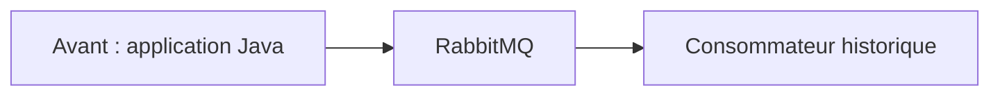
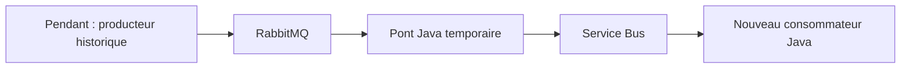
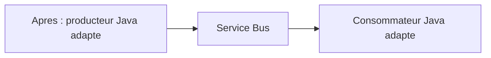
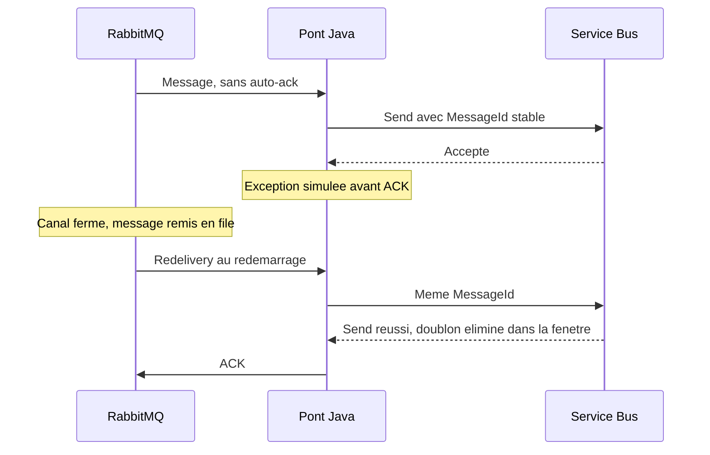

## Preparation avant la session

Construisez et deployez avec le README. Effectuez un passage de `scripts\demo.ps1`
avant l'arrivee du public. Verifiez que RabbitMQ est demarre, que `orders` ne contient
pas de backlog actif et que les permissions Entra ont eu le temps de se propager.
Ouvrez un terminal PowerShell, RabbitMQ Management et la file Azure dans le portail.

```powershell
. .\local.ps1
$run = 'live-' + [guid]::NewGuid().ToString('N').Substring(0, 12)
$jar = '.\target\migration-demo.jar'
docker compose up -d --wait
```

Ne lancez pas en parallele le script automatique et les commandes ci-dessous.
L'identifiant `$run` doit rester le meme jusqu'a la fin du parcours historique.

## Ouverture et architecture, 3 minutes

Dire : "On migre une application Java par etapes. RabbitMQ et Service Bus ne sont pas
deux implementations interchangeables du meme protocole. On conserve le contrat
metier et on adapte les clients ainsi que les topologies."







Preciser : dans ce laboratoire le consommateur historique n'est pas lance.
En production, un consommateur historique et le pont sur la meme file
se partageraient les messages. Ce ne serait pas une copie de chaque message.

## Publier le backlog, 2 minutes

```powershell
java -jar $jar rabbit-depth 0
java -jar $jar publish-rabbit $run
java -jar $jar rabbit-depth 7
```

Montrer les sept `RABBIT_CONFIRMED`, la persistance des messages et le backlog RabbitMQ.
Cinq commandes sont normales, une force un incident transitoire, une autre est invalide.
Le champ `messageId` est une cle stable ; `correlationId` identifie l'execution.

## Couper au pire moment, 4 minutes

```powershell
java -jar $jar bridge 1 crash
java -jar $jar rabbit-depth 7
```

Montrer `SERVICEBUS_ACCEPTED` puis l'exception volontaire.
Il n'y a pas de `RABBIT_ACK` pour ce message.
Le canal se ferme : RabbitMQ remet le message non acquitte a disposition.
Azure a deja accepte le message. Sans identifiant stable et deduplication,
le renvoi pourrait creer un doublon.



```powershell
java -jar $jar bridge 7
java -jar $jar rabbit-depth 0
```

Montrer `redelivered=true`, puis `RABBIT_ACK`.
Ne pas dire qu'un log `SERVICEBUS_ACCEPTED` prouve un nouvel enregistrement :
un send deduplique retourne lui aussi un succes.

## Consommer, rejouer et isoler, 4 minutes

```powershell
java -jar $jar consume $run 6 1
java -jar $jar dlq $run
```

Montrer six `COMPLETE`, un `ABANDON` puis une nouvelle livraison du meme ID,
et une seule commande invalide en DLQ avec `InvalidOrder`.
Le bilan `VERIFIED` controle les totaux et refuse un doublon de livraison metier
dans cette execution. Le peek DLQ ne retire pas les messages.

La reprise transitoire est demontree par `abandon`. Il n'y a pas de backoff applicatif
dans ce petit consommateur ; une exploitation reelle necessite un budget de retries.
La mise en DLQ du message invalide est explicite et immediate.
`maxDeliveryCount=3` est aussi configure cote broker, mais ce scenario ne teste pas
l'epuisement automatique des trois tentatives.

## Basculer le producteur, 3 minutes

```powershell
$native = "$run-native"
java -jar $jar publish-azure $native
java -jar $jar consume $native 3 0
```

Dire : "Le producteur utilise maintenant le SDK Java Azure. Le pont n'est plus
dans le chemin des nouveaux messages. Le contrat de commande reste le meme."

Montrer `NATIVE_AZURE_SENT` puis trois `COMPLETE`.
Dans cette demo, la bascule est un choix de commande CLI, pas un feature flag de production.
Ne decommissionner RabbitMQ qu'apres drainage, reconciliation et validation du rollback.

## Questions frequentes et conclusion, 2 minutes

| Question                         | Reponse                                                                                       |
|----------------------------------|-----------------------------------------------------------------------------------------------|
| Changer seulement l'URL suffit ?  | Non pour ce client RabbitMQ AMQP 0-9-1. Service Bus utilise AMQP 1.0 et un SDK adapte.           |
| Est-ce du exactly-once ?          | Non. Pont at-least-once, deduplication finie et idempotence metier a ajouter.                    |
| Pourquoi Standard ?              | Le scenario utilise la deduplication, absente du SKU Basic.                                    |
| Les secrets sont ou ?            | Pas de cle SAS Azure. Connexion utilisateur Entra via Azure CLI sur le poste.                  |
| Et une fois heberge dans Azure ? | Utiliser une identite managee avec droits Sender/Receiver limites aux entites necessaires.    |
| Les exchanges sont migres ?      | Non. La topologie doit etre repensee en files ou topics/subscriptions et filtres.               |
| Peut-on revenir en arriere ?     | Avant la bascule, figer et reconciler. Apres, un chemin inverse explicite est necessaire.      |

Terminer sur trois preuves observees : reprise sans perte du message non acquitte,
deduplication dans la fenetre configuree, et producteur natif Azure operationnel.
Puis rappeler les travaux de production dans le guide client.
